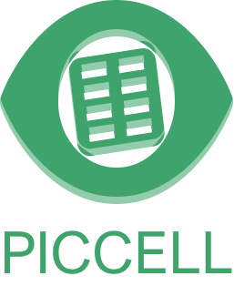
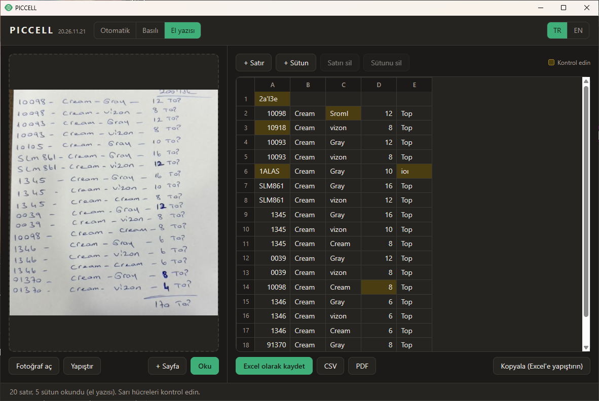

<p align="center">
 
 
</p>

**PICCELL** (picture to cell) turns a photo of a table, **printed or handwritten**, into real Office data: Excel cells, an `.xlsx`, a CSV or a PDF. Right-click a cell in Excel and pick the photo, or open PICCELL and drop the photo on it.

I made PICCELL for someone who gets tables on paper and had to type every number back in by hand: printed from Excel, and more and more often **written by hand** (stock lists like `10098 - Cream - Gray - 12 Top`). Excel's own "Data from Picture" is only in Microsoft 365, not in Excel 2016, 2019, 2021 or LTSC, it needs the internet, and the phone app now wants a subscription too. PICCELL works in all of them, offline.

* **Offline and free.** Printed pages go to the text recognition built into Windows 10 and 11; handwriting goes to PICCELL's own reader, built into the exe. No internet, no account, **the papers never leave the PC**. The only thing that goes online is the update check of the window.
* **Handwriting.** A small neural network, trained on 89 handwriting fonts and on whole pages, reads the lines. Then the page helps: a list is cut at its dashes, a column of numbers is read as digits only, words that come again and again in a column agree with each other, known words win over near misses, and the amounts must add up to the written total.
* **It learns.** A word you fix in the window is read right on the next pages.
* **Made for phone photos.** A turned or slanted photo is straightened, a soft one is sharpened, a grainy one smoothed, pale pencil made darker, and the table borders are erased before reading.
* **Tables drawn by hand.** The wobbly lines of a table drawn with a pen are found and erased; they then say which word is in which cell and row. Two tables on one page come out one under the other, and a cell crossed out by scribbling over it is left out.
* **Real numbers.** `1.234,56` and `12.05.2026` become a number and a date, the same as typing them.
* **Excel, CSV, PDF.** From the window, from Excel, or from the command line. The `.xlsx` and the PDF are written by PICCELL itself, no Office needed.
* **One small program.** One exe of about 2 MB with the reader and the window inside, and an optional Excel add-in. Windows 7 to 11, 64-bit and 32-bit. English and Turkish.
* **Updates itself, only when you open it.** Before the window opens, it looks at the GitHub releases, downloads a new one, checks it with the SHA-256 GitHub gives, and starts as the new version. **Never while you work.**

<details>
  <summary><strong>Table of Contents</strong></summary>

- [Download](#download)
- [Install](#install)
  - [Coming from PICELL or TABLO](#coming-from-picell-or-tablo)
- [How to use](#how-to-use)
  - [The window](#the-window)
  - [In Excel](#in-excel)
  - [Handwriting](#handwriting)
  - [Good photos](#good-photos)
- [Making PICCELL.xlam](#making-piccellxlam)
- [Updates](#updates)
  - [Making a release](#making-a-release)
- [How to compile](#how-to-compile)
- [The command line](#the-command-line)
- [How it works](#how-it-works)
  - [Printed pages](#printed-pages)
  - [Handwritten pages](#handwritten-pages)
- [Training the reader](#training-the-reader)
- [Limits](#limits)
- [Files](#files)
- [Extras](#extras)

</details>

---

# Download

> **The latest version is always here:**
>
> **[PICCELL.exe and PICCELL32.exe][__RELEASES__]**

| EXE                 | For                                    |
| ------------------- | -------------------------------------- |
| **`PICCELL.exe`**   | 64-bit Windows (almost every PC today) |
| **`PICCELL32.exe`** | 32-bit Windows                         |

Both work with 32-bit and 64-bit Excel alike: PICCELL does not depend on Office.

---

# Install

**`PICCELL.exe` alone is enough:** double-click it and its window opens. For Excel's right-click menu, add the add-in too:

1. Put **`PICCELL.xlam`** and **`PICCELL.exe`** into the same folder: **`%APPDATA%\Microsoft\AddIns`** (paste it into the address bar of Explorer).
2. Excel: **File > Options > Add-ins**, at the bottom **Manage: Excel Add-ins > Go...**, tick **PICCELL**. If it is not in the list, **Browse...** to it.
3. Right-click any cell: **Resimden tablo ekle...** is there (**Insert table from picture...** in an English Excel).

> **If the files came by mail, WhatsApp or a download:**
>
> **Right-click `PICCELL.xlam` > Properties > tick Unblock > OK.** Otherwise Windows blocks its macros and the menu never shows up.

**Make a desktop shortcut to the `PICCELL.exe` in the AddIns folder** and open the window from there. Then there is only one copy, and when the window updates it, Excel uses the new one too.

For printed pages the PC needs **Windows 10 or 11**; handwriting and the window also work on Windows 7 and 8. A Turkish Windows usually reads printed Turkish letters already. If not, or on an English Windows, add Turkish under **Settings > Time & language > Language & region > Add a language**, or install only its text recognition (PowerShell as admin):

```powershell
Add-WindowsCapability -Online -Name "Language.OCR~~~tr-TR~0.0.1.0"
```

Without it, numbers still come out right; only letters like `ş`, `ğ` and `ı` may not. The handwriting reader knows Turkish letters by itself.

## Coming from PICELL or TABLO

PICCELL was called **PICELL** for a day, and **TABLO** before that. **The words it learned come along:** the first time PICCELL starts, it copies `%APPDATA%\PICELL\words.txt` (or `%APPDATA%\TABLO\words.txt`) to `%APPDATA%\PICCELL\words.txt`; the old file stays. For Excel, untick the old add-in, delete its `.xlam` and `.exe` from the AddIns folder, and put `PICCELL.xlam` and `PICCELL.exe` there instead.

---

# How to use

## The window

Double-click **`PICCELL.exe`**:

1. **Drop the photo** on the left, or **Fotoğraf aç** (Open photo), or **`CTRL` + `V`** for a copied picture or a photo file copied in Explorer.
   **Only part of it?** Drag a box over the photo. **Kırp** (Crop) cuts it out, or just press **Oku** (Read): only the box is read. **Tüm fotoğraf** (Whole photo) brings the rest back, and `Esc` drops the box. No Paint needed.
2. Pick **Otomatik** (Automatic), **Basılı** (Printed) or **El yazısı** (Handwritten), and press **Oku** (Read). Automatic is right almost always: it tries the Windows OCR first and keeps it only when PICCELL's own reader agrees with what it saw.
3. The table shows up on the right. **Click any cell to fix it.** Cells the reader was not sure of, and cells PICCELL corrected on its own, are **yellow**: check those first. Rows and columns can be added and deleted.
4. **A list of several pages:** open the next photo and press **+ Sayfa** (+ Page). Its rows go under the table, and a header that repeats the first row is left out.
5. **Excel olarak kaydet** (Save as Excel), **CSV** or **PDF** saves it; **Kopyala** (Copy) puts it on the clipboard, ready for `CTRL` + `V` in Excel.

> **Every cell you fix teaches PICCELL that word.**
>
> **It is kept in `%APPDATA%\PICCELL\words.txt`, so the next pages, in the window and in Excel, read it right.**

The window is a web page in a WebView2 window, written in C with my **webview-c-win32**. Windows 10 and 11 have WebView2; on Windows 7 the same page runs in the old Internet Explorer engine. The version is next to the name at the top left (see [Updates](#updates)).

## In Excel

Click the cell where the table should start, then:

| Menu | What it does |
| --- | --- |
| **Resimden tablo ekle...** | Pick the photo file. **`CTRL` + `SHIFT` + `T`** does the same. |
| **Kopyalanan resimden tablo ekle** | Uses a copied picture: a screenshot, a picture copied from WhatsApp, or a photo file copied in Explorer. |

The table appears a moment later, with the columns made wide enough, and the cells to check are **yellow**, the same as in the window. If the cells there are not empty, PICCELL asks first, because **Undo cannot bring them back**. Excel runs PICCELL in **Automatic**, so a handwritten page works the same way.

## Handwriting

PICCELL reads handwriting best when the page is a **list or a table**, because the page itself helps to correct it:

* **Lists** like `10098 - Cream - Gray - 12 Top` are cut at their dashes into columns. `12 Top` becomes two cells, the number and the unit, so Excel can add the numbers up.
* **A column of numbers** is read as digits only (`1O` is `10`), spaces inside a code are dropped (`1 345` is `1345`), and in a column of whole amounts a stray dot goes (`21.` is `21`). In a column of mostly numeric codes, a code with a letter or two is read as digits when its ink allows it (`1OL0S` is `10105`), while `SLM861` stays.
* **A word that comes again and again** in a column wins over a rare one that looks almost the same (`Grau` is `Gray`), when the ink fits it too. A word read once, two letters or less away from a word the same hand wrote again and again on the page, is that word even when the ink fits it badly (`Crarm` and `C(aam` are `Cream`). The same word gets the same case all down the column.
* **Codes** are chosen for the whole column at once: a code that comes again wins over one that is a character or two away, and lines next to each other with the same code win a bit more, because a list often repeats a code on the next lines. A code taken from its neighbours against its ink is yellow.
* **Known words** win over near misses: colours, units (`Top`, `Adet`, `Kg`...), headers and months, in Turkish and English, plus every word you fixed. More can be given with `-words`. A word read the same wrong way thirteen times (`Craam`) is still the known word (`Cream`) read wrong thirteen times.
* **Units:** once the units of the list are known (`Top`), a line whose unit came out as something else (`12 To?` read as `12707`) is read again with them.
* **A total** written under the list is read as a number and one of those units, and it must be the sum of the amounts. When it is not, the one amount whose ink also fits the right number is changed.
* **A date** above the list is read as a date (`23,10.2024` is `23.10.2024`).

**A table drawn by hand** (a grid drawn with a pen, like a shift list) is read cell by cell:

* **Its lines** are found even when they wobble, slant, are pale or go past the corners, and are erased; a letter that touches a line stays. A cell crossed out by scribbling over it is erased too.
* **Its columns** are the drawn lines: words between the same two lines are one cell (`Yarım len`), however far apart they are written.
* **Its rows** are the drawn lines too: a number written higher or lower than the rest of its row is still in that row.
* **More tables on one page** come out one under the other, with an empty row between them, and a line of text under them is one cell.
* **A column of times** is read as times and written with `:` (`00%00`, `11830` and `0730` are `00:00`, `11:30` and `07:30`), so Excel takes them as times. A column of numbers is read as digits (`S` is `5`), and a column of short codes is written in capitals, in the shape of the column (`46` is `V6` when the others are a letter and a digit).
* Bits of the lines left at the ends of a cell (`AB-`) are taken out.

Write with a **dark pen**, keep the **dashes** between the parts, and keep one entry per line. Joined-up cursive is the hardest.

## Good photos

* **Straight from above**, the whole table in the picture, and as close as it still fits.
* **Good light**, no shadow of the phone over the paper.
* Sharp: tap on the paper before taking it.

A small turn or a slanted photo is fine. PICCELL straightens it.

---

# Making PICCELL.xlam

I keep the add-in as plain text (`excel/PICCELL.bas`), so it can be read and changed. Making the `.xlam` takes a minute, once:

1. Excel, an empty workbook: **`ALT` + `F11`**, then **File > Import File...** and pick **`excel/PICCELL.bas`**.
2. Close the editor. **File > Save As**, type **Excel Add-in (\*.xlam)**, name **`PICCELL.xlam`**. Excel offers the AddIns folder; keep it.
3. Copy **`PICCELL.exe`** next to it, then tick it as in [Install](#install).

If the menu ever goes missing, **`ALT` + `F8`** and run **`PICCELL_MENU`**.

---

# Updates

> **PICCELL only updates when you open it, before the window opens. Never while you work.**

First it asks GitHub for the latest release and reads the **SHA-256** GitHub gives for its `PICCELL.exe` (the `digest` you see under every release file; the 32-bit one reads `PICCELL32.exe`). Then it hashes **its own EXE**. **Different hash = update.** So two releases on the same day (`20.26.11.20-Mk1145`, then `20.26.11.20-Mk1151`) work too.

1. **No update:** the window opens. Without internet it opens at once.
2. **Update:** it downloads that `PICCELL.exe` (or `PICCELL32.exe`) into `%TMP%` and checks its SHA-256 against the same `digest` again. Wrong or missing: no update, the window opens.
3. The running EXE **moves itself into `%TMP%`**, the new EXE takes its name and starts, and the old one closes.
4. The new EXE **deletes the old one from `%TMP%`** and opens the window, with **Updated to PICCELL 20.26.11.25.** at the bottom.

When it takes longer than a moment (a slow network, or the download), a small window says what happens: **Downloading PICCELL 20.26.11.25... 45%**. **Close it to skip the update this time**, and PICCELL opens as it is. Two PICCELLs opened at once: only one of them updates.

Two rules keep it safe:

* **Never backwards.** A release whose date is older than the running EXE's version is never installed.
* **Never in the source folder.** A `PICCELL.exe` that sits next to `src\piccell.h` is a test build, so it never replaces itself. Copy it somewhere else to test the updater.

No network, a GitHub rate limit, or a folder PICCELL can not write to (like `C:\Program Files`): nothing happens, PICCELL just works as it is. **The command line, and so the Excel add-in, never goes online**, so it stays fast and offline. **`PICCELL.exe -noupdate`** opens the window without the check.

## Making a release

1. Set the new version in [`src/version.h`](src/version.h). It is the date: `YY.YY.MM.DD`, so 2026/11/20 is `20.26.11.20`.
2. Build with `MAKE.bat` and `MAKE.bat 32`.
3. Make a GitHub release. The tag **starts with the date**, anything after it is yours: **`20.26.11.20-Mk1151`**. Attach **`PICCELL.exe`** and **`PICCELL32.exe`** with exactly those names. A release without `PICCELL32.exe` is fine too: the 32-bit copies just stay as they are.

That's all. GitHub makes the SHA-256 by itself, so there is no `.sha256` file to upload.

> **Packing and signing:** do it in this order: **UPX first, then sign, then upload.** UPX breaks a signature, so signing comes last. GitHub's SHA-256 is made from the file you upload, so the updater checks exactly the packed and signed EXE.

---

# How to compile

You need **MinGW-w64** (gcc and windres). In the PICCELL folder:

```bat
MAKE.bat
```

`PICCELL.exe` appears next to it. **`MAKE.bat 32`** makes `PICCELL32.exe` with the 32-bit gcc in `C:\mingw32\bin`, for 32-bit Windows. `MAKE.bat clean` removes the build files.

Everything PICCELL needs is in the folder. The reader (`res\reader.bin`), the page of the window (`res\ui.html`) and Microsoft's `WebView2Loader.dll` go into the exe as resources, and **webview-c-win32** (`webview\`) is compiled in, so **`PICCELL.exe` is one file** with nothing next to it.

The program does not depend on Office, so a 64-bit `PICCELL.exe` works with 32-bit and 64-bit Excel alike.

---

# The command line

With a picture and a result, `PICCELL.exe` works without its window:

```bat
PICCELL.exe test\ornek.jpg sonuc.xlsx
PICCELL.exe el_yazisi.jpg liste.csv -mode hand -words kelimeler.txt
PICCELL.exe -clip tablo.pdf
```

The kind of the result comes from its name: **`.xlsx`**, **`.csv`** (with `;` and `1.234,56` for Turkish Excel, `,` and `1,234.56` with `-lang en`), **`.pdf`**, or tab separated text for any other name (what the Excel add-in reads).

| Switch | What it does |
| --- | --- |
| `-clip` | Instead of the picture: the picture on the clipboard |
| `-mode auto` | Windows OCR, judged by the reader (the default) |
| `-mode print` | Only the Windows OCR |
| `-mode hand` | Only the handwriting reader |
| `-lang en-US` | The language of the OCR and of the numbers (Turkish by default) |
| `-words <file>` | More known words, one per line |
| `-dump <file>` | Writes every word the OCR saw with its place, for tests |
| `-check <file>` | Writes `1` for every cell to check (yellow in the window) and `0` for the others, tab separated |
| `-noupdate` | Only with the window: no update check |

`test\ornek.jpg` is a photo of a printed table, `test\ornek_dogru.tsv` is what it should give.

| Exit code | Meaning |
| --- | --- |
| `0` | Done |
| `1` | Wrong arguments |
| `2` | Not a picture, or it can not be read |
| `3` | No picture on the clipboard |
| `4` | No Windows text recognition (Windows 10 or 11 needed) |
| `5` | No text in the picture |
| `6` | The result could not be written |
| `7` | No handwriting reader in this `PICCELL.exe` |

---

# How it works

## Printed pages

1. **The photo** is loaded with WIC. The turn the phone saved in it (EXIF) is applied, a small picture is doubled, a huge one is made smaller.
2. **Table borders** are erased: a run of dark pixels longer than 1/30 of the picture is a line, letter strokes are short. The line gets the colour of the paper around it, not a grey average, so no faint line is left for the OCR to read as `l` or `I`. Borders make the OCR glue `|` to the letters, and a column that is still only `l`, `I`, `J` or `|` after that is taken out.
3. **Windows OCR** (`Windows.Media.Ocr`) reads every word with its box. I call it from C through its COM interfaces, so there is no .NET and nothing to install.
4. **The tilt** is the angle where the words stack into the sharpest rows. Every word is turned back by it.
5. **Rows:** every piece of text is linked to the nearest one on its right at the same height.
6. **Columns:** a photo from the side makes the columns lean and narrow towards the far end; the lean that lines them up best is undone. A column border is where almost no row has a word. Then it checks the borders: a real column lines up at its left (text), its right (numbers) or its middle; a "column" that does not is the second word of longer cells (`Matkap Ucu 6`), and a header that only differs in alignment (`Sıra` on the left, `1`, `2`, `3` on the right) joins its numbers.
7. **Clean up:** a lone `,` or `:` that a border left, and a `_` glued to a word (`Güneş_`), are taken out; so is a row of one or two cells with almost nothing in it (`9-`) in a table of fuller rows. In a column of numbers, `O` becomes `0` and `l` becomes `1`, and the amounts are written one way: `12.362.89` among `14.345,22` is `12.362,89`.
8. **Excel** gets every cell as if it was typed, so numbers and dates follow the settings of that PC.

I tested steps 2 and 4 to 7 on about 300 generated photos: turned, slanted, blurred, with and without borders, with empty cells and with debit and credit columns. Rows and columns come out right in about 99% of the cells; what is left is a word the OCR read wrong.

## Handwritten pages

1. **The lines.** The page becomes an ink map: every pixel against the paper around it (the brightest pixel nearby, then the darkest of those, so even the sharp edge of a shadow does not matter). A grainy photo (a dark room) is smoothed first, a soft photo (out of focus, or enlarged) is sharpened, more the softer the edges of its strokes are, and pale strokes (a pencil, a worn pen) count as ink sooner: the reader knows clear, sharp strokes. A photo turned by more than 3.5 degrees is turned back (the angle where the rows of ink are sharpest), and a page photographed from the side, whose lines lean one way at the top and another at the bottom, is straightened row by row. Long ruled lines are erased, and the ink is cut into pieces; a piece taller than 4 letters (the dark edge of the photo, a rule going down) is left out. The page is split into strips about 8 letters wide; in every strip the rows of ink make peaks, and the peaks are linked from strip to strip into lines that may bend. Every piece goes to its nearest line and is moved up or down to level it. Two parts of one line that a wide gap broke apart (`1346 -`, then far to the right `Cream - vizon - 6 Top`) are joined again. A very big photo, or very big letters, are made smaller first; very small writing is made twice as big.
2. **The reader** (`src/reader.c`) is a small convolutional network, about 1.1 million weights stored as int8 (1.1 MB). It looks at a line 32 pixels high and gives, for every 4 columns, how likely each of 93 characters is (CTC). The lines are read on every processor at once.
3. **A list or a table?** Every line is fitted to "a list line of 2, 3, ... parts with a dash between them" (a small grammar the CTC output is decoded with) and votes for the number of parts that fits it best. A faint dash still counts. A lone flat stroke in the middle of a line is taken as a dash by its shape too, because the reader can miss a long thin dash between wide gaps. When most lines agree, it is a list.
4. **A list:** the kind of every column is found (codes, numbers, words, or "number and unit"), and every line is read again with the grammar of its columns: digits only for numbers, no spaces in codes, a number and then a word for `12 Top`. Every word cell then takes the guess with the best score: how well the ink fits it, plus how often it comes in its column, plus a bonus for a known word; two rounds, the second one counting the words as the first one corrected them. The total is read with the units of the list, and the sum is checked. A cell is marked yellow when its word won by a small margin, or when a number or code fits its ink badly, but not when the same word comes three times in its column (or the same code twice).
5. **A table drawn by hand.** Before the pieces are found, thin strokes much longer than a letter are looked for, lying and standing, also pale ones: a lying one 3 letters long may be a line of a table; a standing one is a line when its ends touch those (a cell) or when it is very long; then the lying ones that are very long or touch a standing one are lines too. A stroke with many letters growing out of it (`eam` joined at the bottom) is writing, not a line, and the edge of the photo is no line either. Only the middle of a line is erased, so the foot of an `L` on it stays. With fewer than two standing lines nothing is erased: the page has no table. In a table, a part where a square of 3 strokes fits, as big as a letter and filling most of its piece of ink, is a scribble and is erased too. The standing lines a line of text crosses split it into cells, and the lying lines (put level with the slant of the table) give the row of every word.
6. **Any other page:** the page is cut into parts at wide gaps and at the edges of the drawn tables, and every part goes to the same table maker as the OCR words (`src/layout.c`), after the same corrections; a drawn table is filled from its own lines instead.

---

# Training the reader

The reader is trained in Python with PyTorch, on the CPU, with the scripts in `tools\hand`. Nothing of it is needed to build or use PICCELL; `res\reader.bin` is the result.

```sh
python3 getfonts.py                # handwriting fonts from Google Fonts (fonturls.json)
python3 synth.py 200 20 5000       # 20 x 5000 lines: fonts, slant, waves, pens, paper, JPEG
gcc -O2 -Isrc -o cut_lines tools/cut_lines.c src/ctc.c src/page.c src/reader.c src/layout.c src/words.c -lm
python3 gen_cchunks.py 0 12 5000 ./cut_lines   # whole pages, cut by PICCELL's own C code
python3 train.py 150               # minutes; checks itself on a real page
python3 swa.py avg.pt ck1.pt ck2.pt ck3.pt     # the average of the last checkpoints
python3 export_reader.py avg.pt reader.bin
```

`cut_lines` cuts the lines exactly as `PICCELL.exe` does (sharpened, smoothed, turned back), so the reader learns from what it will really see. `make_test_pages.py`, `gen_drawn.py` (tables drawn by hand), `eval_table.py` and `eval_all.sh` check the whole way from a page to a table against the truth.

---

# Limits

* **Handwriting is not perfect.** Clear writing in a list comes out almost right, and the yellow cells show where to look. Joined-up cursive and very small writing are read worse.
* **One line per cell.** A cell with two lines of text becomes two rows, except in a table drawn by hand; merged cells become one.
* **Corrections between the lines.** A cell crossed out with the right value written above it gives only the part on the line (`03` over a scribble, then `:00`, comes out as `3:00`).
* **Very long numbers** (over 15 digits) lose their last digits, the same as when typing them. Leading zeros (`00123`) go away too.
* **Printed pages need Windows 10 or 11.** Windows 7 and 8 have no OCR; there PICCELL reads every page with its own reader.

---

# Files

| File                                     | What it does                                                        |
| ---------------------------------------- | ------------------------------------------------------------------- |
| [`src/main.c`](src/main.c)               | `PICCELL.exe`: arguments, exit codes; no arguments opens the window |
| [`src/ui.c`](src/ui.c)                   | The window: the page's calls into C, dialogs, the clipboard         |
| [`src/convert.c`](src/convert.c)         | Picture to table (printed, handwritten, automatic), table to file   |
| [`src/picture.c`](src/picture.c)         | Loads the picture (WIC, file, clipboard, memory), JPEG preview      |
| [`src/ocr.c`](src/ocr.c)                 | Runs Windows OCR                                                    |
| [`src/winrt.h`](src/winrt.h)             | The WinRT interfaces, written out by hand                           |
| [`src/lines.c`](src/lines.c)             | Erases table borders                                                |
| [`src/layout.c`](src/layout.c)           | Words to rows and columns                                           |
| [`src/page.c`](src/page.c)               | Finds the lines of a handwritten page                               |
| [`src/reader.c`](src/reader.c)           | The handwriting reader (the network, in plain C)                    |
| [`src/ctc.c`](src/ctc.c)                 | Its output to text: best path, scores, grammars                     |
| [`src/hand.c`](src/hand.c)               | A handwritten page to a table: lists, columns, corrections          |
| [`src/words.c`](src/words.c)             | The built-in known words                                            |
| [`src/export.c`](src/export.c)           | XLSX, CSV and PDF, written by hand                                  |
| [`src/update.c`](src/update.c)           | The updater: GitHub releases, SHA-256, the EXE swap                 |
| [`src/version.h`](src/version.h)         | The version: the release date, `YY.YY.MM.DD`                        |
| [`src/piccell.h`](src/piccell.h)         | The word and the exit codes                                         |
| [`excel/PICCELL.bas`](excel/PICCELL.bas) | The Excel add-in: menus, running `PICCELL.exe`, filling the cells   |
| [`res/piccell.rc`](res/piccell.rc)       | Icon, manifest, version details, and the resources below            |
| [`res/reader.bin`](res/reader.bin)       | The trained reader                                                  |
| [`res/ui.html`](res/ui.html)             | The page of the window                                              |
| [`webview/`](webview)                    | **webview-c-win32**, the window library                             |
| [`tools/hand/`](tools/hand)              | Training and testing the reader (Python)                            |

---

# Extras

* Found a bug or have an idea? [Open an issue][__ISSUES__].
* PICCELL is open source under the **[GPL-3.0](LICENSE)** license.

© 2026 Teoman Deniz - [maximum-tension.com][__SITE__]

[__RELEASES__]: https://github.com/Maximum-Tension/PICCELL/releases/latest
[__ISSUES__]: https://github.com/Maximum-Tension/PICCELL/issues
[__SITE__]: https://maximum-tension.com
